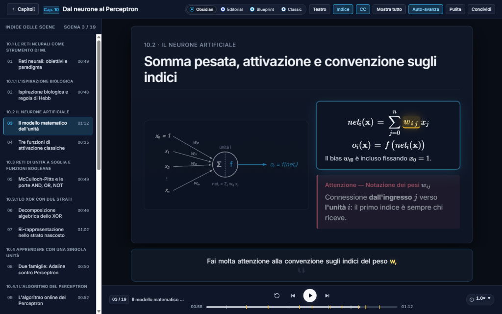
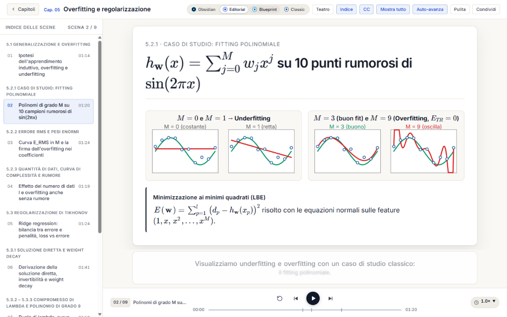

# Machine Learning (654AA) — Videolezioni Interattive

Applicazione web statica per studiare il corso di **Machine Learning (654AA)** della Laurea Magistrale in Informatica dell'Università di Pisa (Prof. Alessio Micheli), basata sulle note riorganizzate di Fabio Piscitelli.

Invece di video MP4 fissi, ogni lezione è renderizzata direttamente nel browser: slide HTML, grafici SVG su dati reali, formule matematiche KaTeX e voce narrante pre-generata si sincronizzano in tempo reale, illuminando blocchi e simboli nel momento esatto in cui vengono spiegati.

**Versione online:** [fabiopsh.github.io/machine-learning-video](https://fabiopsh.github.io/machine-learning-video/)

---

## Anteprima

### Catalogo e mappa del corso
Percorso diviso per parti, ricerca istantanea per capitolo o argomento, filtri di stato, progresso salvato in locale e card per riprendere dall'ultima scena vista.


### Player sincronizzato (tema Obsidian)
Sidebar con indice delle scene, evidenziazione dei simboli nelle formule KaTeX legata alla voce, sottotitoli sincronizzati parola per parola e scrubber con marker dei passaggi chiave.



### Grafici, temi e studio statico (tema Editorial)
Quattro temi intercambiabili (`Obsidian`, `Editorial`, `Blueprint`, `Classic`) e modalità **Mostra tutto** per consultare l'intera slide senza attendere i cue audio.



---

## Come funziona

- **Motore di sincronizzazione deterministico**: ogni capitolo pronto (`videolezioni/lessons/<id>/`) contiene un `lesson.json` con slide HTML/SVG/KaTeX e lista di `cues` temporali (`show`, `highlight`), gli audio per scena e i timestamp parola per parola in `subtitles/*.json`.
- **Nessun backend e nessuna API a runtime**: l'audio viene generato una sola volta in locale; in esecuzione il browser carica solo file statici (più KaTeX e font Inter da CDN).
- **Controlli di studio**: velocità di riproduzione (`0.85×`–`1.5×`), avanzamento automatico tra scene, salvataggio locale delle scene completate (`localStorage`), modalità **Teatro** e **Pulita** (controlli a scomparsa).
- **Link diretti e condivisibili**: ogni capitolo pubblicato su GitHub Pages ha un URL pulito (es. `/10-perceptron/` o `/10-perceptron/?scena=3`), un pulsante **Condividi** nella barra superiore e meta tag Open Graph con cover PNG dedicata per le anteprime su WhatsApp, Telegram e Discord.

### Scorciatoie da tastiera nel player

| Tasto | Azione |
|---|---|
| `Spazio` | Riproduci / Pausa |
| `←` / `→` | Scena precedente / successiva (`Shift` + freccia: `±5 s`) |
| `C` | Mostra / nascondi sottotitoli |
| `S` | Mostra / nascondi indice delle scene |
| `A` | Attiva / disattiva **Mostra tutto** (studio statico) |
| `T` | Modalità **Teatro** |
| `Esc` | Esci da modalità **Pulita** o **Teatro** |

---

## Avvio in locale

Serve Python 3 (nessuna dipendenza esterna richiesta per avviare l'app):

```bash
python videolezioni/scripts/serve.py
```

Apri `http://127.0.0.1:8080/`.

Il server locale implementa `HTTP Range (206)` per consentire lo seeking fluido sugli audio; aprire i file direttamente via `file://` non funziona per via delle chiamate `fetch()` verso i JSON.

---

## Struttura del repository

```text
.
├── videolezioni/                 # Web app statica delle videolezioni
│   ├── index.html                # Catalogo (Mappa del Corso + Griglia Bento)
│   ├── lesson.html               # Player interattivo
│   ├── css/                      # Layout e sistema multi-tema
│   ├── js/                       # Catalogo, player, live-sync voce-formule, macro KaTeX
│   ├── lessons/                  # manifest.json + cartelle dei 20 capitoli (11 pronti)
│   └── scripts/                  # serve.py, build_pages.py, pipeline TTS/allineamento
├── note_migliorate/              # Sorgenti LaTeX, dati delle figure e PDF delle note
├── docs/screenshots/             # Screenshot usati in questo README
└── .github/workflows/
    └── deploy-pages.yml          # Build e deploy automatico su GitHub Pages
```

Per approfondire la pipeline di generazione audio/allineamento vedi [`videolezioni/README.md`](videolezioni/README.md); per la compilazione delle note LaTeX vedi [`note_migliorate/README.md`](note_migliorate/README.md).

---

## Deploy su GitHub Pages

Ogni push su `main` che modifica `videolezioni/` esegue [`.github/workflows/deploy-pages.yml`](.github/workflows/deploy-pages.yml), che lancia `videolezioni/scripts/build_pages.py`:

1. Genera una pagina statica `/<id>/index.html` e una cover Open Graph PNG (`1200×630`) per la home e per ogni capitolo pronto.
2. Comprime in CI gli audio `.wav` in `.mp3` (`80 kbps`, mono 24 kHz) aggiornando i riferimenti nei `lesson.json` di output, senza modificare i `.wav` originali nel repository.
3. Pubblica solo il bundle statico pulito (escludendo script, file `.env` e bozze).

Per testare il build di Pages in locale:

```bash
python videolezioni/scripts/build_pages.py --out videolezioni/dist
python videolezioni/scripts/serve.py --dir videolezioni/dist
```
