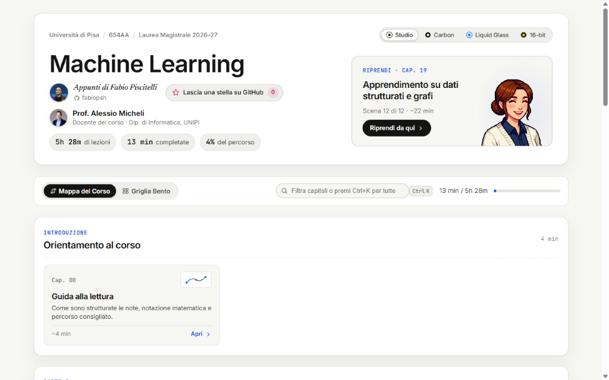
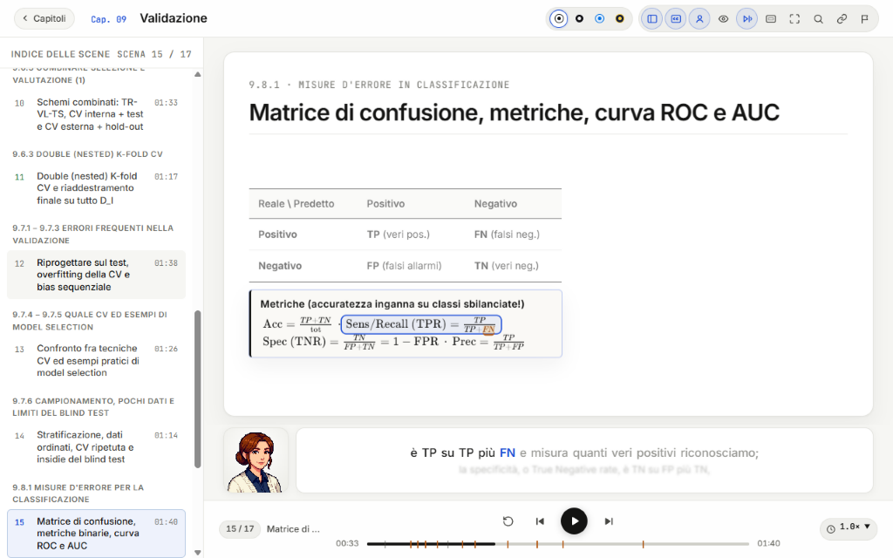
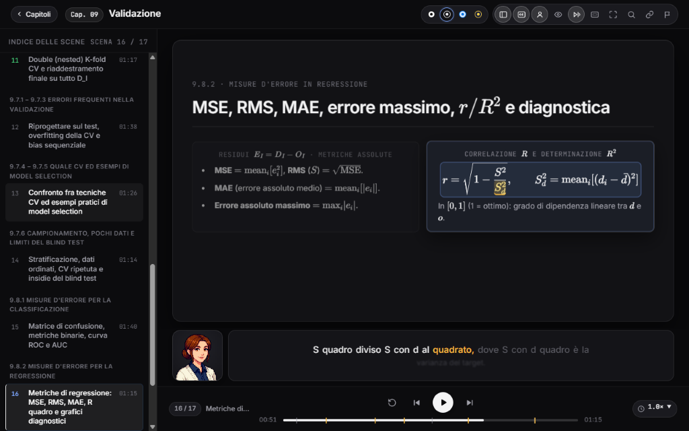
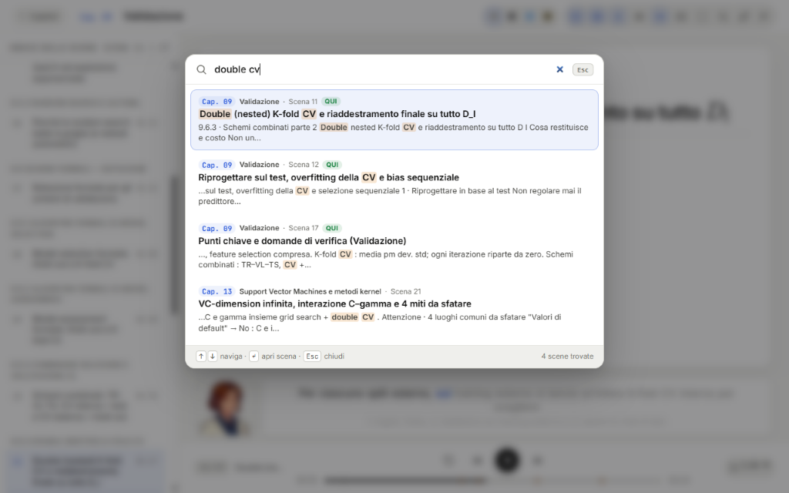

# Machine Learning (654AA) — Videolezioni Interattive

Web app statica per studiare l'intero corso di **Machine Learning (654AA)** della Laurea Magistrale in Informatica dell'Università di Pisa (**Prof. Alessio Micheli**), basata sugli appunti di **Fabio Piscitelli**.

**20 capitoli completi · 231 scene · 5h 28m di lezioni · ~1.560 formule KaTeX · 100% statico (zero backend)**

👉 **Apri le videolezioni online:** [fabiopsh.github.io/machine-learning-video](https://fabiopsh.github.io/machine-learning-video/)



---

## Funzionalità principali

- **Sincronizzazione voce ↔ slide e formule KaTeX**: invece di video MP4 fissi, ogni scena renderizza HTML, grafici SVG e matematica KaTeX nel browser. Mentre la voce spiega, si illuminano in tempo reale il box attivo, i singoli passi/righe e i simboli esatti dentro le formule (`S_d^2`, `FN`, `θ_m`, ...), con sottotitoli sincronizzati parola per parola.
- **Lia, tutor pixel-art sincronizzata**: avatar animato collegato al parlato (attivo in tutte le lezioni e nella home, disattivabile con `V`).
- **Ricerca globale (`Ctrl+K` / `Cmd+K`)**: cerca istantaneamente formule, teoremi, concetti o frasi parlate su tutte le **231 scene** con snippet evidenziati e salto diretto al punto esatto.
- **4 temi intercambiabili al volo**: `Studio` (chiaro editoriale), `Carbon` (scuro grafite), `Liquid Glass` (vetro satinato) e `16-bit` (console retro).
- **Pensato per studiare davvero**: progresso salvato in locale in ore/minuti, vista **Mappa del Corso** o **Griglia Bento**, banner **Capitolo successivo** a fine lezione, velocità `0.85×–1.5×`, modalità **Mostra tutto** (`A`), **Teatro** (`T`) e **Pulita**.
- **Condivisione & feedback immediato**: URL puliti per capitolo e scena (`/<id>/?scena=N`) con cover Open Graph PNG dedicate per Telegram/WhatsApp/Discord e pulsante **Segnala errore** nella topbar che pre-compila una GitHub Issue con capitolo, scena e timestamp esatto.

---

## Anteprime

| Tema **Studio** — sincronizzazione formule, metriche e Lia | Tema **Carbon** — focus formula atomo per atomo |
|---|---|
|  |  |

### Ricerca globale (`Ctrl+K`) su tutte le 231 scene



---

## Scorciatoie nel player

| Tasto | Azione |
|---|---|
| `Ctrl+K` / `Cmd+K` | Apri ricerca globale |
| `Spazio` | Play / Pausa |
| `←` / `→` | Scena precedente / successiva (`Shift` + freccia: `±5 s`) |
| `C` · `V` · `S` | Mostra/nascondi sottotitoli · avatar **Lia** · indice scene |
| `A` · `T` · `Esc` | **Mostra tutto** · modalità **Teatro** · esci da Teatro/Pulita |

---

## Avvio in locale & deploy

Richiede solo Python 3 (nessuna dipendenza esterna per avviare il server con supporto `HTTP Range 206`):

```bash
python videolezioni/scripts/serve.py
# Apri http://127.0.0.1:8080/
```

Il deploy su GitHub Pages è automatico via [`.github/workflows/deploy-pages.yml`](.github/workflows/deploy-pages.yml) usando [`videolezioni/scripts/build_pages.py`](videolezioni/scripts/build_pages.py), che genera le pagine statiche per capitolo, l'indice di ricerca `search-index.json`, le 21 cover Open Graph PNG e la transcodifica audio MP3 in CI.

```text
├── videolezioni/       # App statica, 20 capitoli, live-sync, asset e build script
├── note_migliorate/    # Sorgenti LaTeX e PDF degli appunti riorganizzati
├── docs/screenshots/   # Screenshot del README
└── .github/workflows/  # Pipeline GitHub Pages
```
